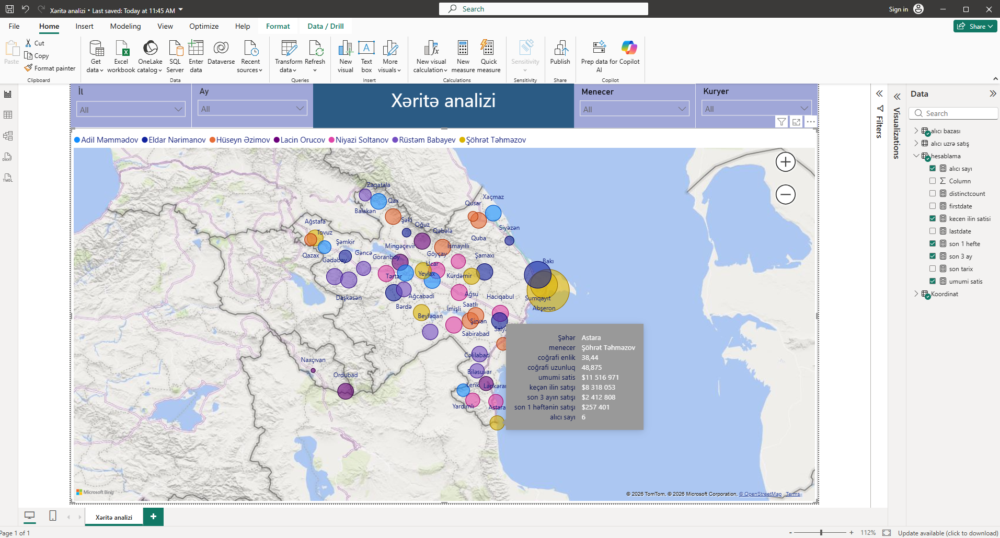

# Xəritə üzrə Satış Analiz Dashboard-u

Bu layihə, şirkətin regional satış fəaliyyətini, şəhərlər və bölgələr üzrə performansını xəritə vizualları (Map Visuals) və qabaqcıl Tooltip (Məlumat İpucu) texnikaları vasitəsilə interaktiv şəkildə təqdim edən Power BI hesabatıdır.

# Dashboard-un Vizual Görüntüsü
Layihəni endirmədən öncə coğrafi hesabatın strukturunu aşağıdan incələyə bilərsiniz:

# Layihənin Məqsədi və Analitik Fokus
* Satış nöqtələrinin coğrafi konsentrasiyasını vizuallaşdırmaq və regional satış trendlərini izləmək.
* İstifadəçinin xəritədəki hər hansı bir şəhərin üzərinə gəldiyi zaman (Hover) həmin nöqtəyə dair kritik biznes göstəricilərini dinamik olaraq görməsini təmin etmək.

# Görülən İşlər və ETL (Power Query) Mərhələsi
1. **İlkin Əməliyyatlar və Data İnteqrasiyası:** Xam regional satış məlumatları Power BI vasitəsilə əldə olunmuşdur.
2. **Datanın Təmizlənməsi:** Coğrafi adların xəritədə düzgün tanınması üçün məlumatlar təmizlənmiş, xətalı simvollar aradan qaldırılmışdır.
3. **Əlaqələrin Qurulması:** Şəhər, Menecer, Kuryer və Satış cədvəlləri arasında düzgün məlumat ötürülməsini təmin edən relyasion əlaqələr konfiqurasiya edilmişdir.

# Hesabatda Tətbiq Edilən Qabaqcıl Vizuallar və Funksiyalar
* **İnteraktiv Filtrlər (Slicers):** Hesabatı İl, Ay, Menecer və Kuryer bazasında dinamik olaraq süzgəcdən keçirmək üçün rahat naviqasiya paneli.
* **Xəritə Vizualı (Map Visual):** Şəhərlər üzrə satış həcmlərini göstərən coğrafi xəritə. Qrafik üzərində Menecerlərin adları rəng fərqlilikləri ilə qruplaşdırılmışdır.
* **Qabaqcıl Tooltip (Xüsusi Məlumat İpucu):** Xəritədəki hər hansı bir şəhərin (məsələn: *Astara*) üzərinə toxunduqda açılan xüsusi pəncərədə aşağıdakı detallı analizlər dinamik şəkildə əks olunur:
  * Şəhərin coğrafi enlik və uzunluq koordinatları.
  * Həmin şəhərə cavabdeh olan **Menecerin adı** (Məsələn: Şöhrət Təhmazov).
  * **Ümumi Satış** məbləği.
  * **Keçən ayın satışı** və zaman analizi əsasında **son 3 ayın satışı**.
  * **Son 1 həftənin satışı** və həmin bölgədəki aktiv **Alıcı sayı**.

## Data Mənbəyi (Source)
* Layihədə istifadə olunan regional xam məlumatlar qovluq daxilindəki `Data_Sources/` bölməsində yerləşir.
